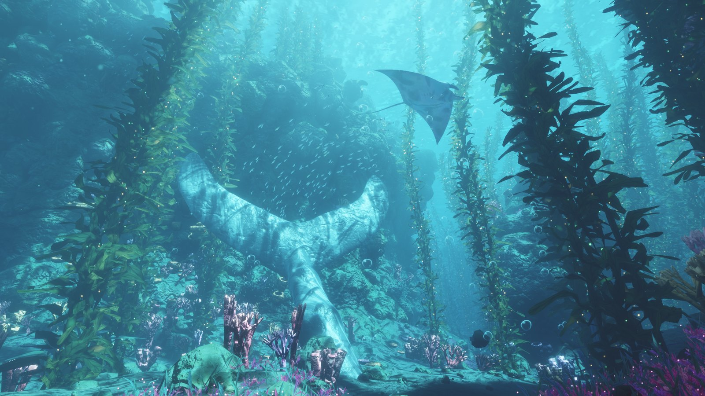
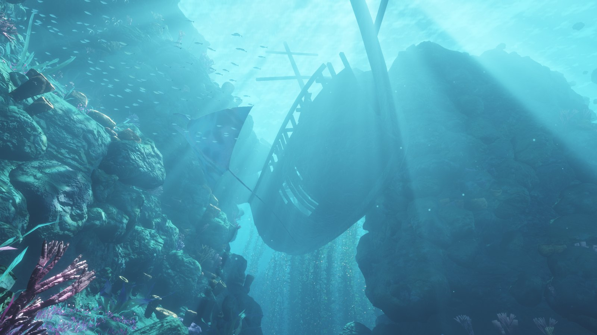
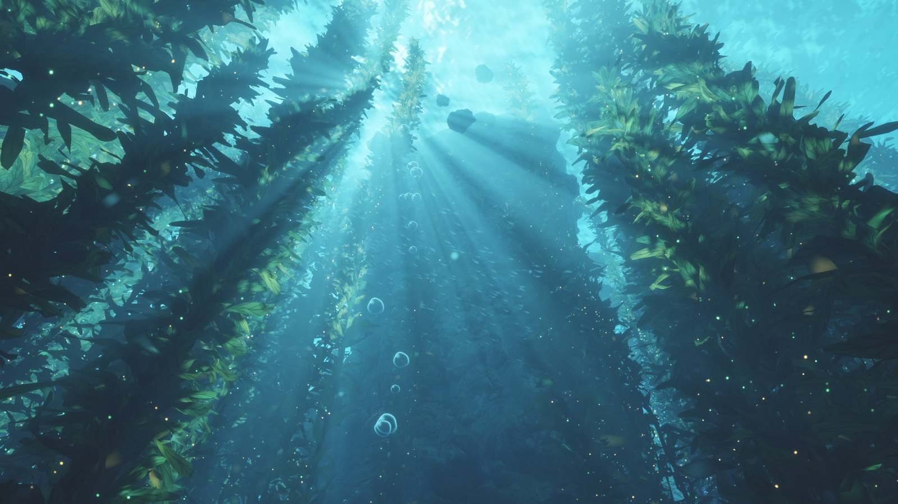
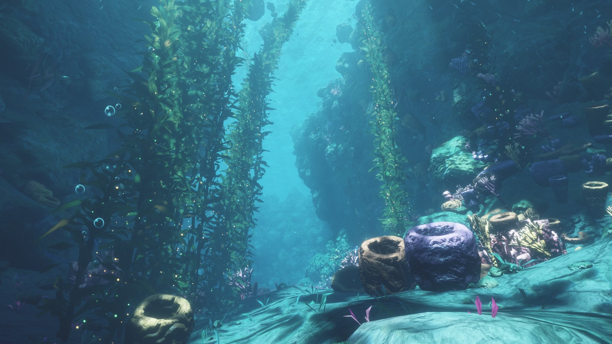
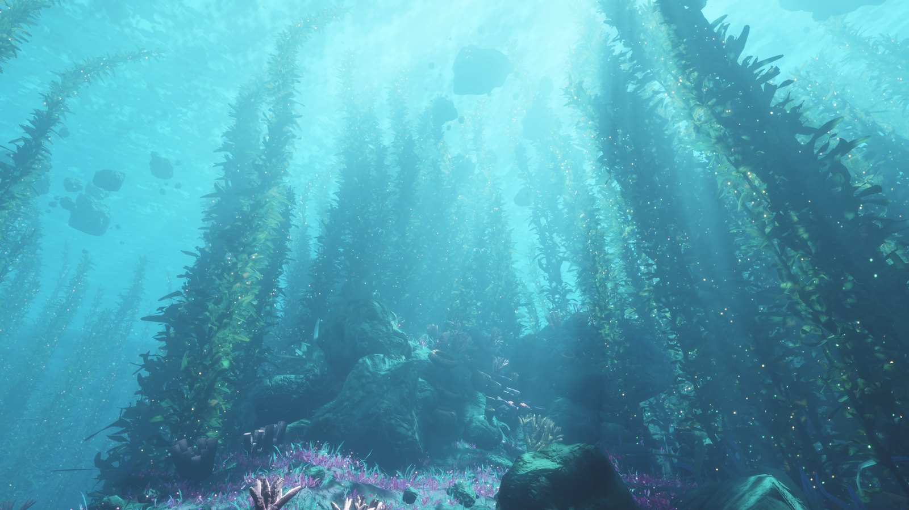
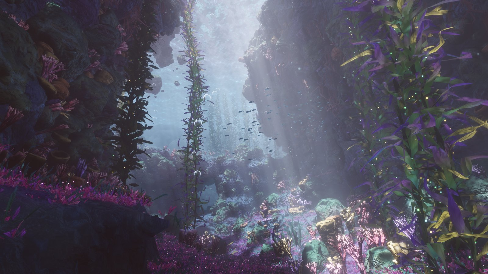

# Abyssal Garden

**A dreamy underwater world you can swim through, right in your browser.**

Towering kelp forests, sunbeams pouring through a rippling surface, a sunken ship, manta rays gliding overhead.
And all of it is made by code: no images, no 3D models, no sound files. The whole world fits in **one 88 KB HTML file**.



## Try it

1. Download [`index.html`](index.html).
2. Open it in **Chrome** or **Edge** on a desktop computer.
3. Wait a few seconds while the world is built, then **click** into the scene and start swimming.

Nothing to install, and it works offline. It needs a browser with **WebGPU**. If you see *"This scene needs WebGPU"*, update your browser or switch to Chrome / Edge.

## What's down there

- **Kelp forests** that sway in the current and sparkle with tiny gold and green specks
- **Light rays** streaming down from a wavy surface, with shimmering caustics on the sea floor
- **A sunken wooden ship**, a **giant stone whale tail**, rock arches, canyons and floating boulders
- **Manta rays**, schools of fish, rising bubbles and drifting particles
- **A purple grotto** with glowing magenta ground cover, coral and barrel sponges
- **A soundscape** made up as you listen: a deep rumble, distant whale calls, soft chimes and bubbles

| | |
|---|---|
|  |  |
|  |  |



## Controls

| | Keyboard & mouse |
|---|---|
| Look around | Click the scene, then move the mouse (`Esc` releases the mouse) |
| Swim | `W` `A` `S` `D` |
| Up / down | `E` / `Q` |
| Swim faster | Hold `Shift` |
| Jump to a viewpoint | `1` to `6` (the spots in the screenshots) |
| Guided tour | `F`, a one-minute flight through the whole world |
| Sound on / off | `M` (sound starts after your first click or key press) |
| Performance stats | `H` |
| Benchmark | `B` runs the guided tour and shows how smoothly it ran |
| Full resolution | `R` (very large screens are rendered at about 1440p unless you press this) |
| Mouse smoothing | `[` less, `]` more |

**On a touchscreen:** hold one finger down to swim forward and slide it to steer. Put a second finger down to go faster. (Touch support is experimental.)

## How it works

- The seabed is sculpted on your graphics card every time the page opens, then decorated with about two million kelp leaves and plants, tens of thousands of rocks, and thousands of sponges, corals and fish.
- Everything is drawn with **WebGPU** directly. No game engine or 3D library is used.
- The ship, whale tail, mantas, fish and corals are built from simple mathematical shapes.
- The sound is synthesized live with the Web Audio API.
- It's built to run smoothly: about 180 fps at 2560×1440 on an RTX 5070 Ti. If your computer struggles, it lowers the resolution automatically to keep things fluid.

## Make it your own

The readable source code is in the [`source`](source) folder. To change something and rebuild `index.html` you need [Node.js](https://nodejs.org) 18 or newer:

```bash
cd source
npm install
npm run build
```

This writes a new `index.html` next to this README. `npm run build:readable` writes an unminified version instead, which is easier to debug in the browser's developer tools.

| File | What's inside |
|---|---|
| [`source/src/world.js`](source/src/world.js) | The world layout: rock walls, arches, tunnels, kelp forests, sponge gardens, fish schools, mantas, the ship and the whale tail. **A good place to start.** |
| [`source/src/shaders.js`](source/src/shaders.js) | The look: water and fog colors, lighting, kelp, rocks, the water surface and light rays (WGSL shader code) |
| [`source/src/main.js`](source/src/main.js) | The renderer, the camera, the controls, the six viewpoints and the guided tour's path |
| [`source/src/audio.js`](source/src/audio.js) | The soundscape |
| [`source/src/math.js`](source/src/math.js) | Noise, random numbers and mesh-building helpers |
| [`source/template.html`](source/template.html) | The page around the scene and the on-screen text |

Some easy first tweaks:

- **Water color:** `WCOL` (blue-green water) and `PCOL` (purple grotto) near the top of the shared scene code in `shaders.js`
- **Sunlight color:** `SUNC` right next to them
- **Brightness and light rays:** `EXPO` and `RAYS` in `main.js`
- **Swimming speed:** search for `26 : 7` in `main.js` (fast speed : normal speed)

## License

[MIT](LICENSE): free to use, change and share, including in your own projects.
