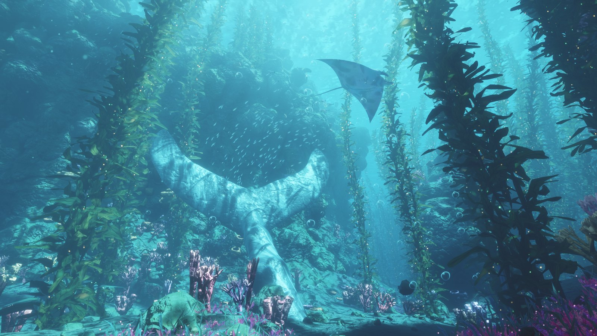
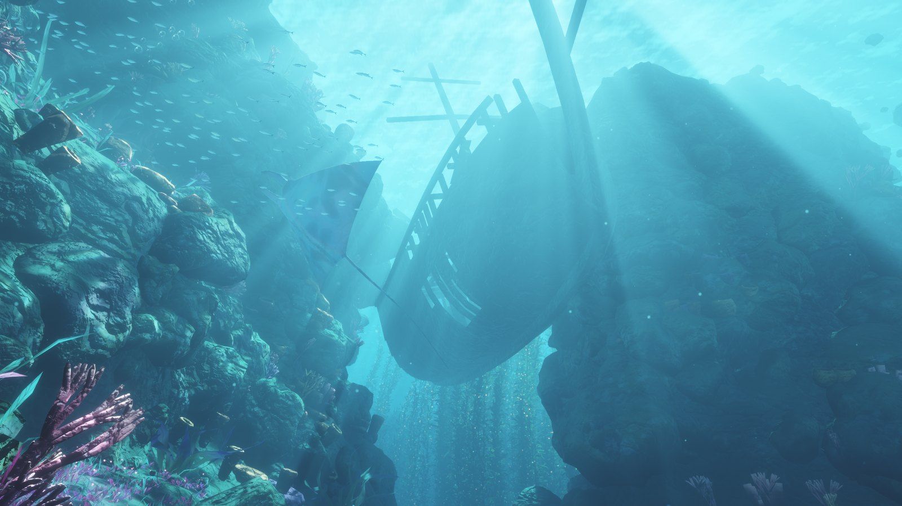
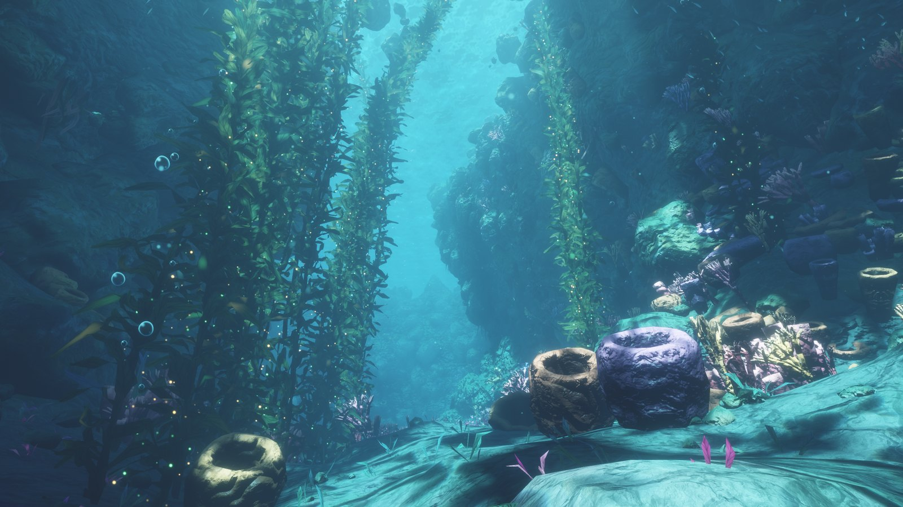
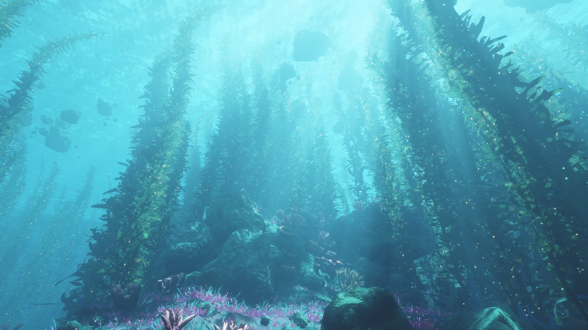
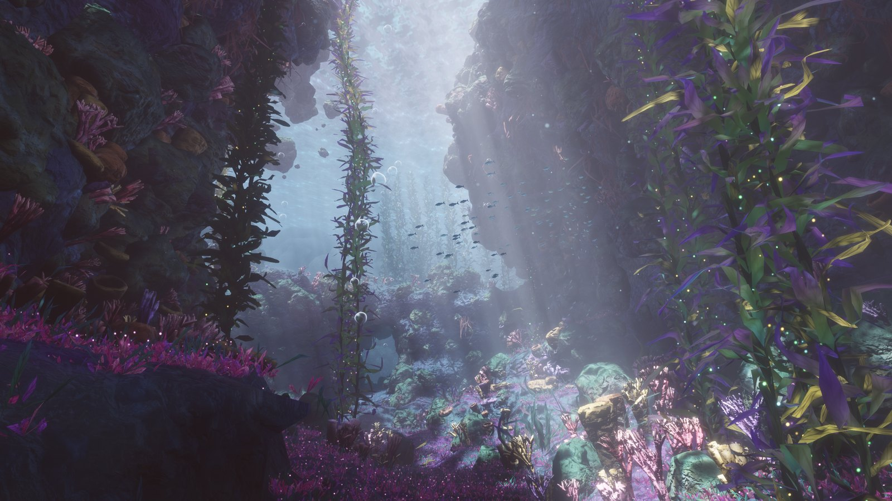

# Abyssal Garden

**A dreamy underwater world you can swim through, right in your browser.**

Towering kelp forests, sunbeams pouring through a rippling surface, a sunken ship, manta rays gliding overhead, bait balls swirling as hunters cut through them, clownfish in their anemones.
And all of it is made by code: no images, no 3D models, no sound files. The whole world fits in **one 117 KB HTML file**.



## Try it

1. Download [`index.html`](index.html).
2. Open it in **Chrome** or **Edge** on a desktop computer.
3. Wait a few seconds while the world is built, then press **Dive in** and start swimming.

Nothing to install, and it works offline. It needs a browser with **WebGPU**. If you see *"This scene needs WebGPU"*, update your browser or switch to Chrome / Edge.

## What's down there

- **Kelp forests** that sway in the current and sparkle with tiny gold and green specks
- **Light rays** streaming down from a wavy surface, with shimmering caustics on the sea floor
- **A sunken wooden ship**, a **giant stone whale tail**, rock arches, canyons and floating boulders
- **Manta rays**, rising bubbles and drifting particles
- **Reef fish** in glowing fantasy colours: clouds of anthias over the coral gardens, triggerfish, parrotfish, pairs of butterflyfish and idols, schools of fusiliers, chromis and blue tang
- **Bait balls**: thousands of silver fish swirling in open water, parting as larger hunters cut through them
- **Anemones** with clownfish among the tentacles, **soft corals** bending in the current, sea whips and carpets of pulsing polyps
- **A purple grotto** with glowing magenta ground cover, coral and barrel sponges
- **A soundscape** made up as you listen: a deep rumble, distant whale calls, soft chimes and bubbles

| | |
|---|---|
|  |  |
|  |  |



## Controls

| | Keyboard & mouse |
|---|---|
| Look around | Move the mouse |
| Swim | `W` `A` `S` `D` |
| Up / down | `E` / `Q` |
| Swim faster | Hold `Shift` |
| Jump to a viewpoint | `1` to `6` (`3` looks up at a bait ball; the others are the spots in the screenshots) |
| Menu | `Esc` releases the mouse and opens the menu with the list of controls; **Resume** takes you back |
| Sound on / off | `M` (sound starts when you dive in) |
| Performance stats | `H` |
| Detail level | **Low**, **Medium** or **High** in the menu (reloads the page) |

The seabed, cliffs and arches are solid: you glide along the rock instead of swimming into it, and you still fit through every tunnel and arch. Kelp, plants, corals, sponges, loose rocks, the floating boulders, the ship and the whale tail you can swim through.

**On a touchscreen:** hold one finger down to swim forward and slide it to steer. Put a second finger down to go faster. The `≡` button in the corner opens the menu. Phones always show the scene in landscape and start on Low or Medium detail. (Touch support is experimental.)

## Detail levels

The **Low**, **Medium** and **High** buttons in the menu pick the detail level; the current one is lit. Each level is the same world, built with less in it:

| Level | What it is | Picked on a first visit for |
|---|---|---|
| **High** | The full scene, with the seabed four times finer near you | Computers |
| **Medium** | Half of the leaves, sparkles and pebbles; small rocks, sponges and corals cast no shadows | Phones with 8 GB of memory |
| **Low** | A quarter of the leaves, no anti-aliasing, coarser rocks and corals, simpler lighting, 480p to start with | Other phones, and computers with 4 GB of memory or less |

If loading crashes the tab, or the graphics driver gives up, the page starts again one level lower. Your browser remembers the level, and the resolution and draw distance the scene settled on, for the next visit.

## How it works

- The seabed is sculpted on your graphics card every time the page opens, then decorated with about two million kelp leaves and plants, tens of thousands of rocks, thousands of sponges and corals, and about fourteen thousand fish.
- Everything is drawn with **WebGPU** directly. No game engine or 3D library is used.
- The ship, whale tail, mantas, fish and corals are built from simple mathematical shapes.
- Nothing is simulated: every fish, tentacle and kelp blade works out where it is from the clock alone, on the graphics card. A bait fish gets out of a hunter's way by asking where that hunter is right now.
- Whatever you swim close to is lit by a soft diver's lamp, so nearby rock and coral show their true colours.
- The sound is synthesized live with the Web Audio API.
- It's built to run smoothly: about 8 ms of graphics time per frame at 2560×1440 on an Apple M5 Max (about 110 fps on its 120 Hz display), and about 180 fps on an RTX 5070 Ti before the reef life was added. On slower hardware it aims for 60 fps by lowering first the resolution and then how far away plants and rocks are drawn, in small steps. The scene is already running, blurred, behind the start menu, so most of that tuning is done before you dive in. A low-end phone (Samsung Galaxy A16) reaches about 20 fps at 670×372 on Low.

## Make it your own

The readable source code is in the [`source`](source) folder. To change something and rebuild `index.html` you need [Node.js](https://nodejs.org) 18 or newer:

```bash
cd source
npm install
npm run build
```

This writes a new `index.html` next to this README. `npm run build:readable` writes an unminified version instead, which is easier to debug in the browser's developer tools.

`npm run build:dev` writes a separate `dev.html` with two extra tools that are not part of `index.html`: `F` flies the camera along a one-minute path through the whole world, and `B` runs that flight as a benchmark and reports frame and GPU times. The same tools can be driven from the address bar (`dev.html?pose=3&time=20`, `?fly=12.5`, `?bench=1`) or from the console through `window.dev`.

| File | What's inside |
|---|---|
| [`source/src/world.js`](source/src/world.js) | The world layout: rock walls, arches, tunnels, kelp forests, sponge gardens, fish schools, mantas, the ship and the whale tail. **A good place to start.** |
| [`source/src/shaders.js`](source/src/shaders.js) | The look: water and fog colors, lighting, kelp, rocks, the water surface and light rays (WGSL shader code) |
| [`source/src/main.js`](source/src/main.js) | The renderer, the camera, the controls, the six viewpoints and the camera path the world is laid out around |
| [`source/src/audio.js`](source/src/audio.js) | The soundscape |
| [`source/src/quality.js`](source/src/quality.js) | The detail levels: which one a device starts on, and what is remembered between visits |
| [`source/src/math.js`](source/src/math.js) | Noise, random numbers and mesh-building helpers |
| [`source/src/dev.js`](source/src/dev.js) | Development tools (fly-through and benchmark), only in `dev.html` |
| [`source/template.html`](source/template.html) | The page around the scene: loading bar, start menu, links and their styles |

Some easy first tweaks:

- **Water color:** `WCOL` (the water's own blue) and `PCOL` (purple grotto) near the top of the shared scene code in `shaders.js`; `KD` and `SIG` next to them set how fast each color fades with depth and distance (raise the middle number for less green)
- **Fish:** the lists of schools, clouds, bait balls and loners are in the fish section of `world.js`; their colors and patterns are in `fsFish` in `shaders.js`
- **Sunlight color:** `SUNC` right next to them
- **Brightness and light rays:** `EXPO` and `RAYS` in `main.js`
- **Swimming speed:** search for `26 : 7` in `main.js` (fast speed : normal speed)

## License

[MIT](LICENSE): free to use, change and share, including in your own projects.
