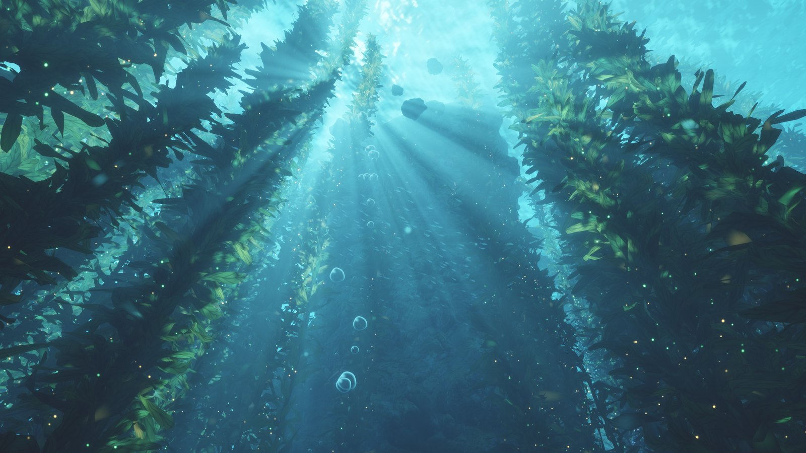

# Abyssal Garden

**A dreamy underwater world you can swim through, right in your browser.**

Towering kelp forests, sunbeams pouring through a rippling surface, a sunken ship, manta rays gliding overhead.
And all of it is made by code: no images, no 3D models, no sound files. The whole world fits in **one 96 KB HTML file**.


## Try it

1. Download [`index.html`](index.html).
2. Open it in **Chrome** or **Edge** on a desktop computer.
3. Wait a few seconds while the world is built, then press **Dive in** and start swimming.

Nothing to install, and it works offline. It needs a browser with **WebGPU**. If you see *"This scene needs WebGPU"*, update your browser or switch to Chrome / Edge.

## What's down there

- **Kelp forests** that sway in the current and sparkle with tiny gold and green specks
- **Light rays** streaming down from a wavy surface, with shimmering caustics on the sea floor
- **A sunken wooden ship**, a **giant stone whale tail**, rock arches and canyons
- **Manta rays**, **great white sharks**, schools of fish, rising bubbles and drifting particles
- **A purple grotto** with glowing magenta ground cover, coral and barrel sponges
- **The world above the water:** swim up through the surface and look out over a rippling sea with sky, clouds and sun glitter (you sink back once you stop swimming up)
- **Blacktip reef sharks**: three smaller, fast sharks that cruise along the sea floor (about twice the speed of the big sharks), swerving by up to 30 degrees now and then, always steering clear of the rocks and away from the thick kelp (they roam the open sea floor). Black tips on the dorsal fin (over a white band), the other fins and the tail, like the ones in the Maldives; a slight, slow tail beat and a steady cruise just above the floor. When one swerves, the nose turns first and the body follows the path the head took, bending in an S. They are solid too, show as yellow dots on the map, and `8` puts you in the path of one
- **A livelier sea floor**: low flat ground is rippled sand and silt (ripples run across the current), with soft contact shadows under rocks and plants. Sea urchins, starfish, shells and sea cucumbers lie on it; colonies of garden eels sway in the current and sink into the sand when you come close; table corals, brain corals and anemones (with clownfish) grow on the reefs.
- **Small touches**: slow cloud shadows drift over the sea bed, drifting particles follow the current, your head sways very slightly when you're underwater, and fish shy away when you swim close.
- **Camera and water**: depth of field (soft distance, soft foreground) and motion blur when you sprint or turn fast; swimming close to the sand stirs up puffs of sediment that your wake drags back, then spread, drift and settle.
- **More life**: small reef fish (tangs, damsels, anthias) around the reefs, jellyfish drifting in open water, and faintly glowing particles in the deep.
- **Sound with a place**: the low rumble of the vents grows as you approach and pans to where they are; a blacktip passing close is heard as a pressure whoosh.
- **Sleeping nurse sharks**: tawny ochre, blotched with dark spots, sleeping in piles of four to six on the flat sea floor, noses together and slender, S-curved bodies fanned out like spokes, slowly flapping their pointed fins, swaying their tails and blinking now and then as they breathe. They are solid, like rocks, and each group is a red pin on the map
- **Four dark tunnels** winding through the big rock walls and the pillar: swim in at one mouth and find your way to the other. Inside it is pitch black, so your torch switches itself on a few metres in (with a click) and off again on the way out. Both ends of every tunnel are marked on the map with an orange dot and the tunnel's letter
- **A little map circle** (bottom right) showing where you are, which way you look and where the six viewpoints are
- **An underwater current** that carries you gently in one direction while you bob up and down, if you float still
- **A soundscape** made up as you listen: underwater only muffled, deaf "blop blop" bubbles and the diver's own breathing; above the surface wind, swell, lapping ripples and gulls, with a splash as you break through

| | |
|---|---|
|  |  |
|  |  |


## Controls

| | Keyboard & mouse |
|---|---|
| Look around | Move the mouse |
| Swim | `W` `A` `S` `D` or the arrow keys |
| Geyser (easter egg) | `G` takes you to the geyser; swim over it |
| Long tunnel | `T` drops you above its first shaft; it runs under the sea floor from one end of the world to the other (the torch switches on by itself) |
| Easter eggs | The first tunnel shaft is a downdraft that pulls you in. Hang still by a quiet spot on the deep floor and a whale sings and passes overhead. After a while in the dark with the torch on, glow fish gather in its beam. Hang still near the floor for a minute and a shark comes to circle you. Hang still near the surface and jellyfish drift in to a ring around you. The geyser throws you 400 m up (about 9 s) over a made-up archipelago that goes on to the horizon, with the sound dying away as you climb; you fall back, drifting to a landing on the water ~28 m from the geyser. |
| Easter egg shortcuts | `G` geyser · `T` tunnel entrance · `U` whale spot (hold still) · `I` glow fish · `O` downdraft · `P` shark · `J` jellyfish · `K` the 400 m throw |
| Up / down | `E` / `Q` |
| Swim faster | Hold `Shift`, or tap `↑` twice quickly and hold it on the second tap |
| Jump to a viewpoint | `1` to `6` (the spots in the screenshots) |
| Visit the sleeping nurse sharks | `7` (press again for the next group) |
| Meet the blacktip reef sharks | `8` (puts you in the path of one; press again for the next) |
| Menu | `Esc` releases the mouse and opens the menu with the list of controls; **Resume** takes you back |
| Sound on / off | `M`, or the **Sound** buttons in the menu (remembered; sound starts when you dive in) |
| Map circle on / off | `N` |
| Performance stats | `H` |
| Detail level | **Low**, **Medium** or **High** in the menu (reloads the page) |

The seabed, cliffs and arches are solid: you glide along the rock instead of swimming into it, and you still fit through every tunnel and arch. Kelp, plants, corals, sponges, loose rocks, the ship and the whale tail you can swim through. Sharks, blacktip reef sharks, manta rays and the sleeping nurse sharks are solid too: you can't swim through their bodies, fins or wings, and you slide along them (fish are small enough to swim through).

**On a touchscreen:** hold one finger down to swim forward and slide it to steer. Put a second finger down to go faster. The `≡` button in the corner opens the menu. Phones always show the scene in landscape and start on Low or Medium detail. (Touch support is experimental.)

## Detail levels

The **Low**, **Medium** and **High** buttons in the menu pick the detail level; the current one is lit. Each level is the same world, built with less in it:

| Level | What it is | Picked on a first visit for |
|---|---|---|
| **High** | The full scene | Computers |
| **Medium** | Half of the leaves, sparkles and pebbles; small rocks, sponges and corals cast no shadows | Phones with 8 GB of memory |
| **Low** | A quarter of the leaves, no anti-aliasing, coarser rocks and corals, simpler lighting, 480p to start with | Other phones, and computers with 4 GB of memory or less |

If loading crashes the tab, or the graphics driver gives up, the page starts again one level lower. Your browser remembers the level, and the resolution and draw distance the scene settled on, for the next visit.

## How it works

- The seabed is sculpted on your graphics card every time the page opens, then decorated with about two million kelp leaves and plants, tens of thousands of rocks, and thousands of sponges, corals and fish.
- Everything is drawn with **WebGPU** directly. No game engine or 3D library is used.
- The ship, whale tail, mantas, fish and corals are built from simple mathematical shapes.
- The sound is synthesized live with the Web Audio API.
- It's built to run smoothly: about 180 fps at 2560×1440 on an RTX 5070 Ti. On slower hardware it aims for 60 fps by lowering first the resolution and then how far away plants and rocks are drawn, in small steps. The scene is already running, blurred, behind the start menu, so most of that tuning is done before you dive in. A low-end phone (Samsung Galaxy A16) reaches about 20 fps at 670×372 on Low.

## Make it your own

The readable source code is in the [`source`](source) folder. To change something and rebuild `index.html` you need [Node.js](https://nodejs.org) 18 or newer:

```bash
cd source
npm install
npm run build
```

This writes a new `index.html` next to this README. `npm run build:readable` writes an unminified version instead, which is easier to debug in the browser's developer tools.

`npm run build:dev` writes a separate `dev.html` with two extra tools that are not part of `index.html`: `F` flies the camera along a one-minute path through the whole world, and `B` runs that flight as a benchmark and reports frame and GPU times.

| File | What's inside |
|---|---|
| [`source/src/world.js`](source/src/world.js) | The world layout: rock walls, arches, tunnels, kelp forests, sponge gardens, fish schools, mantas, the ship and the whale tail. **A good place to start.** |
| [`source/src/shaders.js`](source/src/shaders.js) | The look: water and fog colors, lighting, kelp, rocks, the water surface and light rays (WGSL shader code) |
| [`source/src/main.js`](source/src/main.js) | The renderer, the camera, the controls, the six viewpoints and the camera path the world is laid out around |
| [`source/src/audio.js`](source/src/audio.js) | The soundscape |
| [`source/src/quality.js`](source/src/quality.js) | The detail levels: which one a device starts on, and what is remembered between visits |
| [`source/src/math.js`](source/src/math.js) | Noise, random numbers and mesh-building helpers |
| [`source/src/dev.js`](source/src/dev.js) | Development tools (fly-through and benchmark), only in `dev.html` |
| [`source/template.html`](source/template.html) | The page around the scene: loading bar, start menu, links and their styles |

Some easy first tweaks:

- **Water color:** `WCOL` (blue-green water) and `PCOL` (purple grotto) near the top of the shared scene code in `shaders.js`
- **Sunlight color:** `SUNC` right next to them
- **Brightness and light rays:** `EXPO` and `RAYS` in `main.js`
- **Swimming speed:** search for `26 : 7` in `main.js` (fast speed : normal speed)

## License

[MIT](LICENSE): free to use, change and share, including in your own projects.
